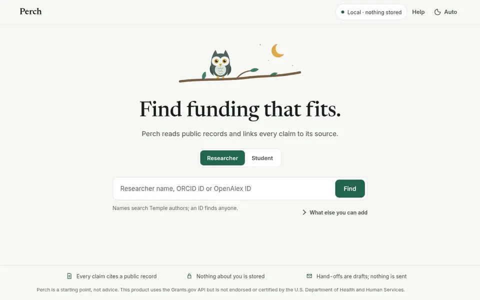
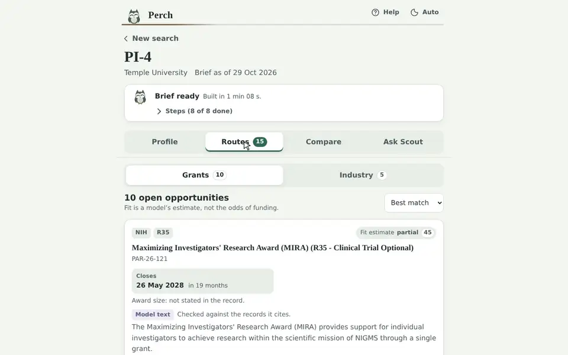
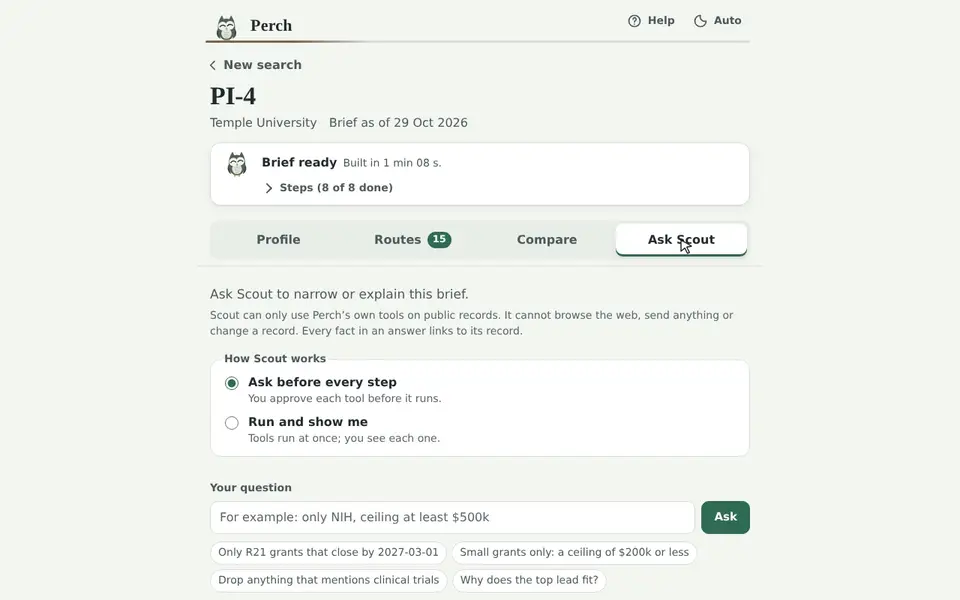
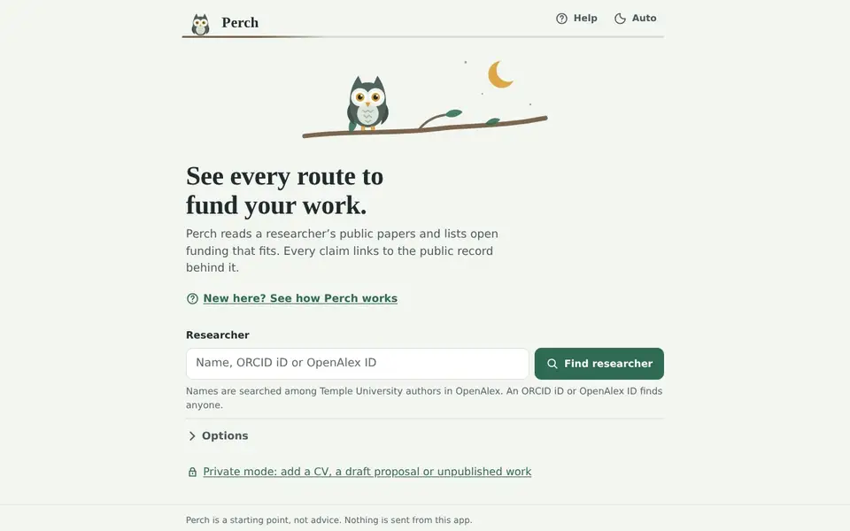
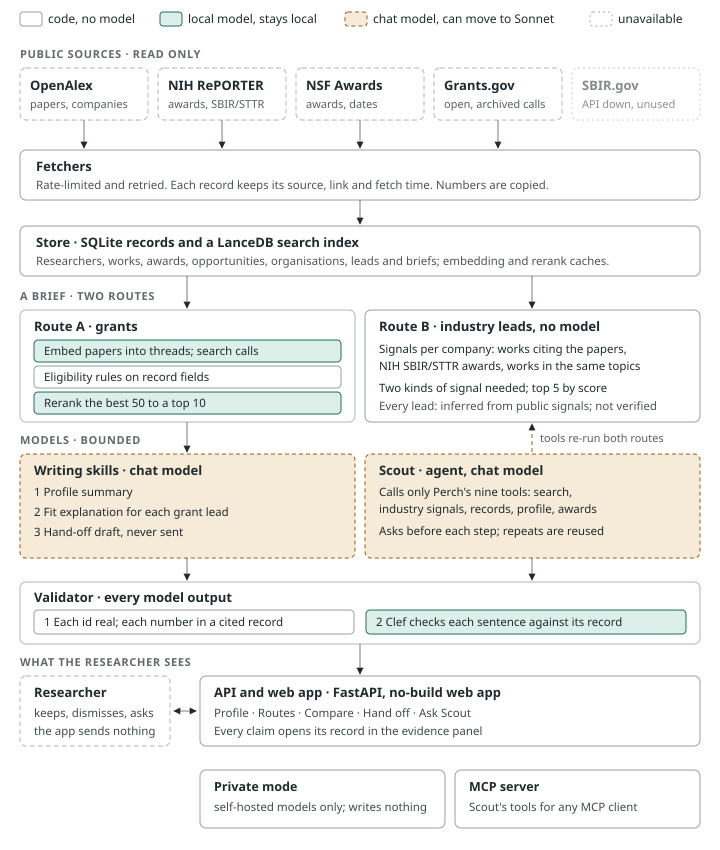

<div align="center">


# Perch

**See every route to fund your work.**

Perch reads a researcher's public papers and lays out the ways to fund that work:
open federal grants and industry leads. Every claim is cited to a public record.
Then it drafts a hand-off to the right Temple office, which you send yourself.


[](LICENSE)

**[Quick start](#quick-start)** · **[Tour](#a-quick-tour)** · **[How it works](#how-it-works)** · **[How well it works](#how-well-it-works)** · **[Docs](#learn-more)**



<sub>Find a researcher, build the brief, and open the record behind any claim.</sub>

</div>

<table>
<tr>
<td align="center" width="33%"><br><b>Every claim has a record</b><br><sub>Dates and amounts are copied, never generated.</sub></td>
<td align="center" width="33%"><br><b>Keeps nothing about you</b><br><sub>Every brief lives in memory, on local models by default.</sub></td>
<td align="center" width="33%"><br><b>Nothing is sent</b><br><sub>Hand-offs are drafts for you to edit.</sub></td>
</tr>
</table>

## Quick start

Perch needs [uv](https://docs.astral.sh/uv/) and `make`. uv installs Python 3.12 and every pinned dependency on first run.

```bash
git clone https://github.com/dakshitha-a/Perch && cd Perch
make test                              # lint and every test; no network or GPU
uv run perch serve --models fake       # the whole app at http://127.0.0.1:8100, with fake models
```

With real models, a brief needs Ollama for the chat model and a GPU for the embedder and reranker:

```bash
uv sync --extra ml
uv run perch brief A5026494099 --explain      # an OpenAlex author id
```

Every command is in [docs/running.md](docs/running.md), and the two-GPU demo is in [docs/deploy.md](docs/deploy.md).

## A quick tour

> Researchers appear by alias in these clips. Paper titles and funding records are public and are shown as they are.

<table>
<tr>
<td width="50%"></td>
<td width="50%">

### Grants that fit, with the reasons

Perch groups a researcher's papers into research threads, and searches open
Grants.gov announcements from every federal agency (NIH, NSF, DoD, DOE and the
rest) by meaning and by shared words. Rules drop anything a
university cannot apply to. A small local model puts the closest first.

Each lead says what the call funds and which papers fit it. A citation check
holds every sentence to the record it cites.

</td>
</tr>
<tr>
<td>

### Industry leads from public signals

Perch looks for three kinds of signal: company papers that cite the
researcher's, NIH small-business awards in their topics, and company papers in
those topics. A company needs two kinds to be listed. No model writes these:
plain code counts the signals and shows the records behind each.

Every industry lead is labelled as inferred, not as verified interest.

</td>
<td></td>
</tr>
<tr>
<td></td>
<td>

### Compare, then hand off

Keep the leads worth a closer look: they collect in a shortlist beside the list.
Compare them side by side: money, close date, activity code and evidence, each
copied from its record.

Then draft an email to the Temple office for that route. A model writes only a
short opening. Code writes the list of leads, dates and amounts. You edit it and
send it yourself.

</td>
</tr>
<tr>
<td>

### Ask Scout a follow-up

"Which of my NSF leads close by 1 Mar 2027?" or "Why does the top lead fit?". Scout,
the agent, answers by calling Perch's own nine tools. Above each answer, "How Scout read
your question" lists every step with its filters; the step cards fold under Steps. New
conversation, beside the question box, starts over. Scout cannot browse, send anything
or change a record.

On a student brief, Scout has its own rule-based tools instead. Other agents can
use the researcher tools through Perch's [MCP server](docs/mcp.md), Claude Code
included.

</td>
<td></td>
</tr>
<tr>
<td></td>
<td>

### Private by default, local models first

Perch has no accounts, so it keeps nothing about you: every brief is a
session held in memory, and only public records are cached. Models run on
the server. The chip at the top, "Local · nothing stored", opens a choice: the
model work can go to a cloud provider instead, after a warning that names it.

After picking the researcher, open Tell Perch more to add a direction, keywords or
a draft proposal that steer the search, and a CV that the career-stage rules read.
Documents stay on local models unless you choose Cloud and confirm, in a second
warning that lists them, which documents leave. Exports leave their text out, or mask it. A canary
test checks that no trace is left in files, logs or requests.
[More on privacy →](docs/private-mode.md)

</td>
</tr>
<tr>
<td>

### Student mode, on sample data

Choose Student, and Perch opens a private session first. Paste or upload a CV,
and add a note on your interests or a few achievements. Perch lists fellowships from public
records and scholarships from a sample database. It checks each one against
your CV by rule, and lists what you would still need. Ask Scout works here too.

Every sample record is invented and badged **Sample data**. On 24 planted test
cases, the rules matched every case that reached a brief; retrieval missed 1 of
the 12 a student could apply for.
[Scores →](bench/results/STUDENT_MODE.md)

</td>
<td></td>
</tr>
</table>

<sub>The private-mode and student clips use invented personas, labelled SYNTHETIC. The scholarships are from an invented sample corpus.</sub>

**Real data for student mode.** The sample corpus stands in for a real
scholarship feed. Temple already runs ScholarshipUniverse for its students,
so the natural source is Temple's own feed, used under its contract; a licensed
scholarship database would also work. Neither publishes a schema, so Perch has
one documented place where a feed maps in (`perch/sources/scholarshipuniverse.py`).
The proposed owner is Student Financial Services, with Scholar Development and
Fellowships Advising for fellowships, to be agreed with those offices.

## How it works

<picture>
  <source media="(prefers-color-scheme: dark)" srcset="docs/architecture/overview-dark.svg">
  
</picture>

- **Public records only:** OpenAlex, NIH RePORTER, NSF Award Search and Grants.gov. Each record is stored with its source, link and fetch time.
- **The pipeline is code:** fetching, eligibility, retrieval and ranking run the same way every time. The back-test measures this pipeline.
- **One score:** each lead's Match, from 0 to 100, is the ranking model's score on a fixed scale, and the list is sorted by it. It says how closely the listing's text matches the papers, not the odds of funding.
- **Models are bounded:** a model writes the profile summary, the fit explanations and the hand-off opening. Scout can call only allowlisted tools.
- **Every model output is checked:**
  - **Code check:** every id must be real, and every date or number must be in a cited record.
  - **Grounding check:** a second model checks each sentence against its source.
  - **On failure:** an output that fails is rewritten once, then withheld.
- **Any provider:** Ollama, any OpenAI-compatible server, or the Anthropic API, chosen per role in `.env`.

The brief step by step and the two-GPU layout are in [docs/ARCHITECTURE.md](docs/ARCHITECTURE.md).

## How well it works

Every number here was measured. Each is copied from [bench/results](bench/results/SUMMARY.md), with the keyword-only baseline beside the back-test.

| What | Result |
|---|---|
| **Back-test:** for 48 Temple NIH awards, did the announcement each was funded under rank in the top 10? Only papers from before the award count. | 10 of 48 with Perch's default setup, against 2 of 48 for keyword search alone. The default was tuned on these same 48 awards, and placed 7 before that, so part of the gain is fitted to them |
| **Citation and grounding checks,** on 30 leads | Gemma 4 26B-A4B passed both on 28; Claude Sonnet on 24 |
| **Scout,** 20 scripted follow-ups | Claude Sonnet completed 20, with no wrong-tool calls; Gemma 4 26B-A4B completed 18 |
| **Cost of a 10-lead brief** | about $0.09 on Claude Sonnet; $0 on local models |
| **Live canary** | no trace in files, logs or model-server journals after full briefs, with and without documents |

- **An upper bound, not an estimate:** each award's own funded abstract was added as a stand-in "draft proposal". With the current setup, it lifted the back-test from 10 to 17 of 48 in the top 10. A real draft is further from the award than its funded abstract.
- **General calls are hard:** for awards made under broad parent announcements, Perch puts 2 of 78 in the top 10.
- **Industry leads, judged once:** the agent that built Perch judged 14 leads: 8 good, 6 thin and 0 wrong. A person has not checked them yet.

## Known limits

- **No monitoring:** Perch keeps nothing about its users, so it cannot watch a researcher for changes. The weekly watch is shelved in `perch/shelved/monitor/` until a user system exists.
- **Refresh by hand:** open opportunities are refreshed when the operator runs `perch fetch opportunities` and re-indexes; a researcher's cached papers and awards are not refreshed on their own.
- **Every brief is live:** apart from the demo researchers' briefs, which the server builds when it starts, nothing is reused, so each brief runs the models again; one brief with explanations took 46 s on the demo models in S23.
- **Cloud is narrow by design:** with Cloud on, only the summary, the fit explanations and the hand-off opening use the cloud model. A session's documents go with them only after the user confirms a second warning that lists each one; that consent lasts for the session. A zero-data-retention cloud key is not built.
- **Sessions do not index:** opportunities fetched since the pipeline last indexed are not searched in a brief.
- **One announcement, several cards:** related announcements of one family (for example, one call with and without a clinical trial) are listed separately.
- **Company names are not merged:** two names for one company can appear as two industry leads.
- **The hand-off opening has one check:** the model-written paragraph passes the citation check, but not the second, grounding check.
- **Scout on a local model:** Gemma sometimes states a count that the citation check then withholds.
- **Untested pairing:** the MCP server was tested with Claude Code, not with a local Ollama agent.
- **Student mode is a demonstration:** its scholarships are invented sample records. In planted tests, the search missed 1 of the 12 records a student could apply for. Public fellowship listings get "may be eligible" at most, because their own pages set the full rules.

## Learn more

| | |
|---|---|
| [Running Perch](docs/running.md) | Setup, the command line, keys and data sources |
| [Deploying the demo](docs/deploy.md) | Two GPUs, one `make demo`, the public URL and the fallback |
| [Privacy](docs/private-mode.md) | What is stored, Local or Cloud, your documents, and how it is checked |
| [MCP server](docs/mcp.md) | Perch's tools in Claude Code or any MCP client |
| [Architecture](docs/ARCHITECTURE.md) | The system, a brief step by step, and the GPU layout |
| [Bench results](bench/results/SUMMARY.md) | The back-test, the checks, Scout and cost |
| [Sources](docs/SOURCES.md) | Every endpoint, field, limit and term, verified live |
| [Specification](docs/SPEC.md) and [plan](docs/PLAN.md) | The design, and how it was built session by session |
| [AI use](docs/AI_USE_LOG.md) | Every AI tool used to build Perch |

## About

Perch was built by Dakshitha (Temple University) for the Temple AI Build Challenge, Fall 2026,
with Claude Code as the coding agent. The README clips were filmed with the recording pipeline
from Dakshitha's [NextTex](https://github.com/dakshitha-a/NextTex).

This product uses the Grants.gov API but is not endorsed or certified by the U.S. Department of
Health and Human Services. MIT licence; see [LICENSE](LICENSE).
