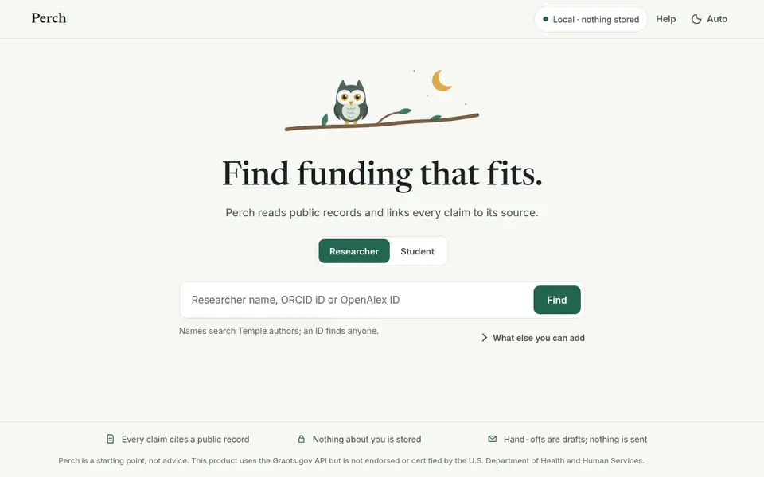
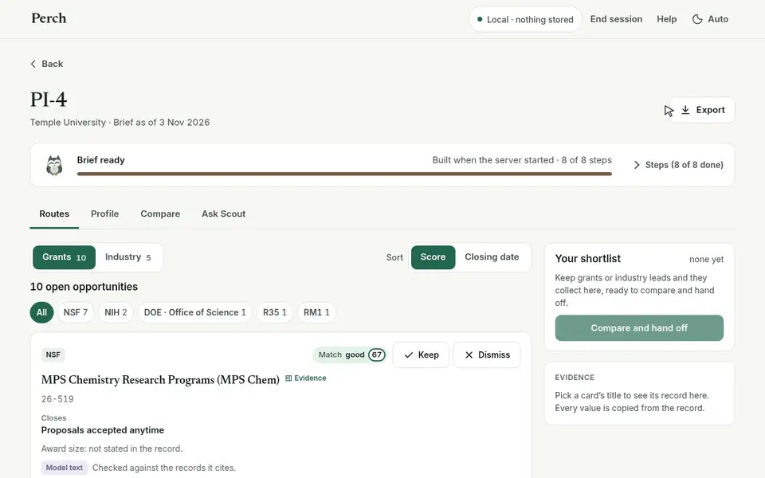

<div align="center">


# Perch

**See every route to fund your work.**

**[Run it locally](#quick-start)**

Funding calls are spread across many agencies and offices. Perch puts the ones that fit your own papers, or your CV, in one cited list.

Perch reads a researcher's public papers, or a student's CV, and lays out the routes to fund that work.
A researcher gets open federal grants and industry leads. A student gets public fellowships and sample scholarships.
Every claim is cited to its record.
Perch then drafts a hand-off to the right Temple office, which you send yourself.


[](LICENSE)

**[Quick start](#quick-start)** · **[Tour](#a-quick-tour)** · **[Results](#results)** · **[How it works](#how-it-works)** · **[Known limits](#known-limits)** · **[Docs](#learn-more)**


</div>

- **Every claim has a record.** Dates, amounts and eligibility are copied from records, never generated.
- **Keeps nothing about you.** Every brief lives in memory, on local models by default.
- **Nothing is sent.** Hand-offs, notes and cover-letter points are drafts for you to edit.

## Quick start

Perch needs [uv](https://docs.astral.sh/uv/) and `make`. uv installs Python 3.12 and every pinned dependency on first run.

```bash
git clone https://github.com/dakshitha-a/Perch && cd Perch
```

Start the whole app with fake models:

```bash
uv run perch serve --models fake
```

Then open http://127.0.0.1:8100 in a browser. To lint and run every test, with no network or GPU:

```bash
make test
```

With real models, a brief needs Ollama for the chat model and a GPU for the embedder and reranker:

```bash
uv sync --extra ml

# The argument is an OpenAlex author ID.
uv run perch brief A5026494099 --explain
```

Every command is in [docs/running.md](docs/running.md). The two-GPU demo is in [docs/deploy.md](docs/deploy.md).

## A quick tour

> Researchers appear by alias in these clips. Paper titles and funding records are public and are shown as they are. The student clips use an invented SYNTHETIC persona and sample scholarships.

### Grants that fit, with the reasons

Perch groups a researcher's papers into research threads. It searches open Grants.gov calls from every federal agency, by meaning and by shared words. Rules drop anything a university cannot apply to, and a small local model puts the closest first. Each lead says what the call funds and which papers fit it. A citation check holds every sentence to the record it cites.

### Fellowships and scholarships that fit your CV

Choose Student and add a CV, and a note on your interests if you like. Perch lists public fellowships and sample scholarships, each checked against your CV by rule: eligible, may be eligible or not eligible, with what you would still need. A short model sentence says why it may fit. Where a fellowship's own page states a deadline or an amount, code copies it with the sentence it came from. Every sample record is invented and badged **Sample data**. On 24 planted test cases the rules matched every case that reached a brief. Retrieval missed 1 of the 12 a student could apply for. That checks the mechanism, not real scholarships. [Scores →](bench/results/STUDENT_MODE.md)



### Industry leads from public signals

A company is listed when it shows two of three public signals. Its papers cite the researcher. It holds NIH small-business awards in the topic. Its papers share the topic. Plain code counts the signals and shows the records. No model writes these leads. Every lead is labelled inferred, not verified.



### Compare, then hand off

Keep the leads worth a closer look and compare them side by side. Money, close date, NIH activity code (such as R01) and evidence are copied from each record. Then draft an email to the Temple office for that route. A model writes only a short opening. Code writes the rest. The screen notes that every grant proposal goes through ERA for institutional review. You edit the email and send it yourself. A student's fellowships and sample scholarships compare in separate tables, and code writes the whole note.


### Ask Scout a follow-up

Ask "Which of my NSF leads close by 1 Mar 2027?" or "Why does the top lead fit?". Scout answers by calling Perch's own ten tools. "How Scout read your question" lists every step and its filters. Scout cannot browse, send anything or change a record. A student brief has its own eight tools. Other agents, Claude Code included, can use the researcher tools through Perch's [MCP server](docs/mcp.md), a standard way for AI agents to call tools.


### Points for your cover letter

Ask Scout "What could my cover letter for the top lead say?". A student asks "What should my application for my top option highlight?". Perch returns three to six points for that one record. Each pairs what the record asks for, cited to the record, with what you have, cited to your CV, a document, a paper or a public award. Up to three gaps name what nothing you added shows. A set that fails the checks is rewritten once, then withheld. The points sit on the card with Copy, for you to put in your own words. They never enter an export or a hand-off.


### Private by default

Perch has no accounts. Every brief is a session held in memory, and only public records are cached. A session holds a researcher brief or a student brief, never both. The chip at the top, "Local · nothing stored", can send the model work to a cloud provider after a warning that names it. Documents you add under Tell Perch more stay on local models unless you choose Cloud and confirm a second warning that lists them. Export saves the full brief. The "Mask my ongoing research" box hides phrases from your draft, direction or unpublished work. Hand-off drafts leave document text out by default. A canary test, a planted marker string, checks that no trace is left in files, logs or requests. [More on privacy →](docs/private-mode.md)


## Results

Every number here was measured. Each is copied from [bench/results](bench/results/SUMMARY.md), with the keyword-only baseline beside the back-test.

| What | Result |
|---|---|
| **Back-test:** for 48 Temple NIH awards, did the announcement each was funded under rank in the top 10? Only papers from before the award count. | 10 of 48 with Perch's default setup. Keyword search alone gets 2 of 48. The default was tuned on these same 48 awards. It placed 7 before tuning, so part of the gain is fitted to them. |
| **Citation and grounding checks,** on 30 leads | Gemma 4 26B-A4B, a local open model, passed both on 28. Claude Sonnet passed 24. |
| **Scout** | On the current 30 questions, the local Gemma model answered all 30, with no wrong-tool calls, in one run on 2 Nov 2026. Claude Sonnet answered 28 of 28 on the earlier 28-question set. |
| **Cost of a 10-lead brief** | About $0.09 on Claude Sonnet. $0 on local models. |
| **Live canary** | No trace in files, logs or model-server journals after full briefs, with and without documents. |

- **Back-test date:** the default's 10 of 48 comes from the 30 Oct 2026 tuning round. The table of other setups was rendered on 29 Oct 2026.
- **An upper bound, not an estimate:** each award's own funded abstract was added as a stand-in "draft proposal". With the current setup, it lifted the back-test from 10 to 17 of 48 in the top 10. A real draft is further from the award than its funded abstract.
- **General calls are hard:** for awards made under broad parent announcements, Perch puts 2 of 78 in the top 10.
- **Industry leads, judged once:** the agent that built Perch judged 14 leads: 8 good, 6 thin and 0 wrong. A person has not checked them yet.
- **Brief time:** a live brief takes about 40 s on the demo models.
- **Cover-letter points:** the points have one bench task. It passed in one local run. That is not a rate.

## How it works

<picture>
  <source media="(prefers-color-scheme: dark)" srcset="docs/architecture/overview-dark.svg">
  
</picture>

- **Public records only:** OpenAlex, NIH RePORTER, NSF Award Search, Grants.gov, and Temple's fellowship list with each fellowship's own page. Each record is stored with its source, link and fetch time.
- **The pipeline is code:** fetching, eligibility, retrieval and ranking run the same way every time. The back-test measures this pipeline.
- **One score:** each lead's Match, from 0 to 100, is the ranking model's score on a fixed scale, and the list is sorted by it. It says how closely the listing's text matches the papers, not the odds of funding.
- **Models are bounded:** a model does four jobs. It writes the profile summary, the fit explanations and the hand-off opening. When you ask Scout, it also writes cover-letter points for one record.
- **Offices:** a researcher's hand-off goes to Research Development for grants, or to Innovation and Technology Commercialization for industry leads.
- **Your CV and documents:** a session's models may read them, with emails, phone numbers, links and ORCIDs blanked first. Code still reads the CV by rule for eligibility. Nothing from them is stored.
- **Every model output is checked:**
  - **Code check:** every ID must be real, and every date or number must be in a cited record.
  - **Grounding check:** a second model checks each sentence against its source.
  - **On failure:** an output that fails is rewritten once, then withheld.
- **Any provider:** Ollama, any OpenAI-compatible server, or the Anthropic API, chosen per role in `.env`.

The brief step by step and the two-GPU layout are in [docs/ARCHITECTURE.md](docs/ARCHITECTURE.md).

### Deployment modes

Every model call goes through one provider layer, and every model role is a setting. The person deploying Perch chooses how it runs. This is their decision, not the app's.

- **Fully local:** every role on self-hosted models. No API key is needed. Nothing leaves the server.
- **Hybrid:** models are local by default. The user may turn on a Local / Cloud switch for a session, after a warning that names the provider. This is how the demo runs.
  - **Documents:** a session that holds documents gets a second warning. It lists each document that would leave. A CV and unpublished research are named separately.
  - **Consent:** nothing is sent until the user confirms. The consent lasts for that session. A document added later turns Cloud off until it is confirmed too.
- **Cloud only:** every role on a hosted provider.

If a hosted provider is used, the deployer also decides whether the API key is a zero-data-retention key, if the provider offers one. The privacy statement should say so. The settings and a pre-deployment checklist are in [docs/deploy.md](docs/deploy.md). The reasoning is in [docs/ARCHITECTURE.md](docs/ARCHITECTURE.md#deployment-choice-local-hybrid-or-cloud).

## Known limits

- **Student mode is a demonstration.** Its scholarships are invented sample records. Public fellowship listings get "may be eligible" at most, because their own pages set the full rules.
- **No monitoring.** Perch keeps nothing about its users, so it cannot watch a researcher for changes. The weekly watch is shelved in `perch/shelved/monitor/` until a user system exists.
- **Every brief is live.** Apart from the demo researchers' briefs, which the server builds when it starts, nothing is reused. Each brief runs the models again.
- **Cover-letter points are model text.** A person has not checked them. A record that states little beyond its title gives few points. In one test, 425 of 663 open NIH listings gave fewer than three checklist points. See [bench/results/draft_review](bench/results/draft_review/RESULTS.md).

<details>
<summary>All known limits</summary>

- **Refresh by hand:** open opportunities are refreshed when the operator runs `perch fetch opportunities` and re-indexes. Opportunities fetched after the last indexing are not searched in a brief. A researcher's cached papers and awards are not refreshed on their own.
- **Most fellowship pages give no dated deadline.** The 2 Nov 2026 fetch read 64 of 76 pages. It found 4 deadlines and 11 amounts on 15 records.
- **Cloud is narrow by design:** with Cloud on, only the summary, the fit explanations, the hand-off opening and the cover-letter points use the cloud model. A session's documents go with them only after the user confirms a second warning that lists each one. A zero-data-retention cloud key is not built.
- **One announcement, several cards:** related announcements of one family are listed separately. One example is a call with and without a clinical trial.
- **Company names are not merged:** two names for one company can appear as two industry leads.
- **The hand-off opening has one check:** the model-written paragraph passes the citation check, but not the second, grounding check.
- **Scout on a local model:** Gemma sometimes states a count that the citation check then withholds.
- **Untested pairing:** the MCP server was tested with Claude Code, not with a local Ollama agent.
- **Student mode needs a real feed.** The sample corpus stands in for a real scholarship feed. Temple's own ScholarshipUniverse feed, used under its contract, is the natural source. ScholarshipUniverse publishes no schema, so Perch has one documented place where a feed maps in (`perch/sources/scholarshipuniverse.py`). The proposed owner is Student Financial Services, with Scholar Development and Fellowships Advising for fellowships, to be agreed with those offices.
- **Retrieval misses some records.** In planted tests, the search missed 1 of the 12 records a student could apply for.

</details>

## Learn more

- [Running Perch](docs/running.md): setup, the command line, keys and data sources.
- [Deploying the demo](docs/deploy.md): two GPUs, one `make demo`, the public URL and the fallback.
- [Privacy](docs/private-mode.md): what is stored, Local or Cloud, your documents, and how it is checked.
- [MCP server](docs/mcp.md): Perch's tools in Claude Code or any MCP client.
- [Architecture](docs/ARCHITECTURE.md): the system, a brief step by step, and the GPU layout.
- [Results](docs/RESULTS.md) and [bench results](bench/results/SUMMARY.md): the back-test, the checks, Scout and cost.
- [Sources](docs/SOURCES.md): every endpoint, field, limit and term, verified live.
- [Specification](docs/SPEC.md) and [plan](docs/PLAN.md): the design, and how it was built session by session.
- [AI use](docs/AI_USE_LOG.md): every AI tool used to build Perch.

## About

Perch was built by Dakshitha (Temple University) for the Temple AI Build Challenge, Fall 2026,
with Claude Code as the coding agent. The README clips were filmed with the recording pipeline
from Dakshitha's [NextTex](https://github.com/dakshitha-a/NextTex).

This product uses the Grants.gov API but is not endorsed or certified by the U.S. Department of
Health and Human Services. MIT license; see [LICENSE](LICENSE).
