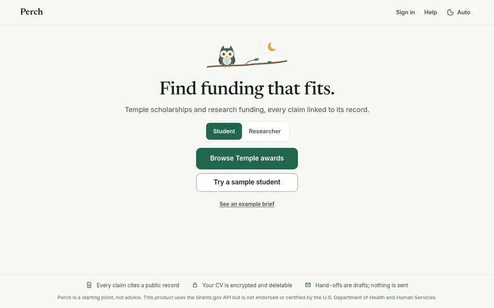
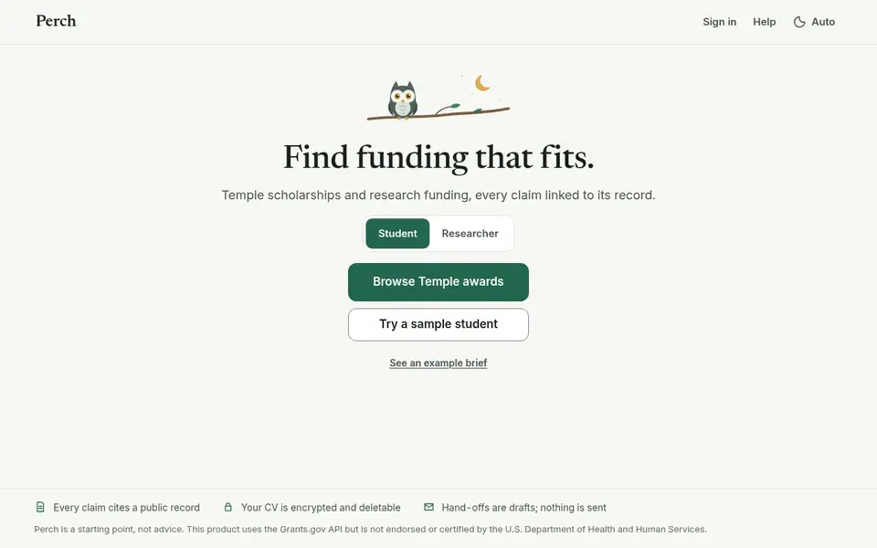
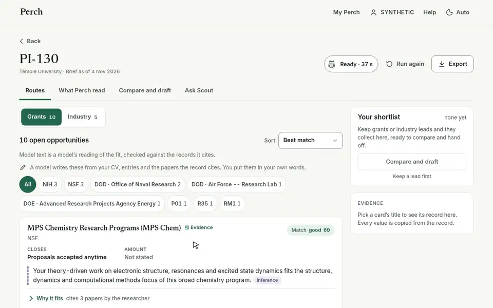
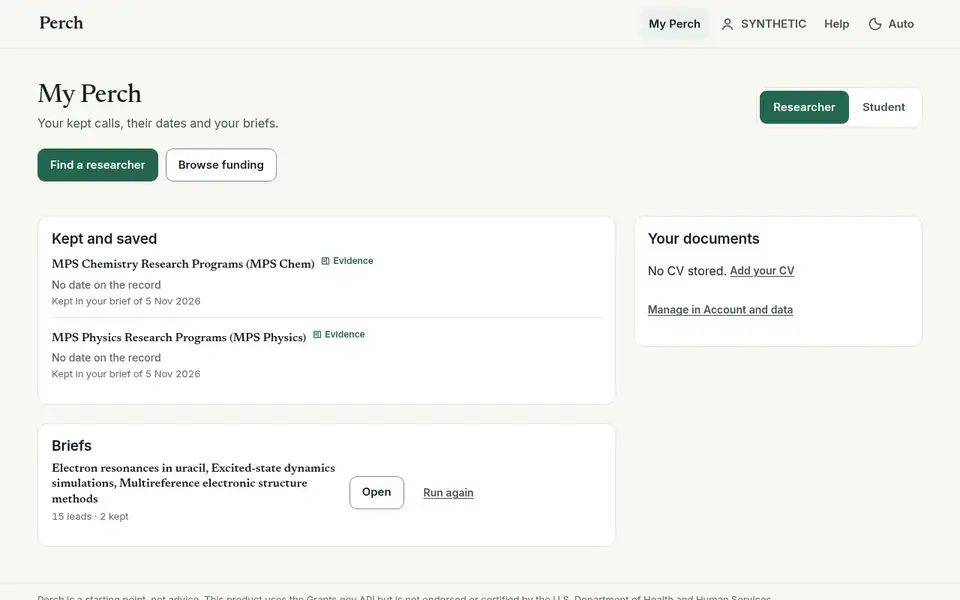
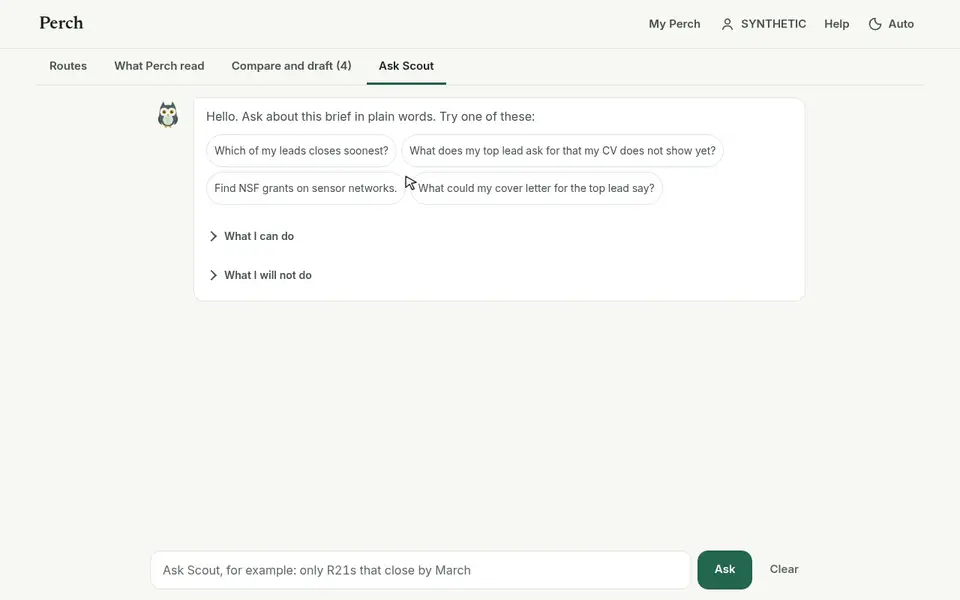
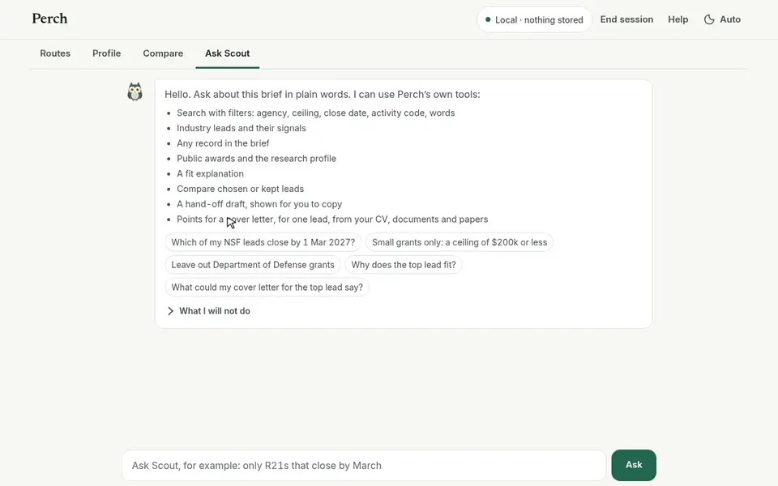

<div align="center">


# Perch

**See every route to fund your work.**

**[Run it](#quick-start)** · **[Take the tour](#tour)**

Funding calls are spread across many agencies and offices. Perch puts the ones that fit your own papers, or your CV, in one cited list.

**See it:** on a running deploy, the example brief page (`/example.html`) shows a finished researcher brief, built on public papers and shown by alias, and a SYNTHETIC student brief. The example files are not tracked in this repository, so the page works only on a deploy that serves them.


[](LICENSE)

**[Quick start](#quick-start)** · **[Tour](#tour)** · **[Accounts](#sign-in-and-guest-mode)** · **[Your data](#what-is-stored-and-how-it-is-protected)** · **[Evaluation](#evaluation)** · **[Limits](#known-limits)** · **[Docs](#learn-more)**

</div>

## What Perch does

- **For a student:** Perch reads a CV you add and lists fellowships and scholarships, each checked against the CV by rule. A student can also browse Temple's awards without a CV.
- **For a researcher:** Perch reads the researcher's public papers and lists open federal grants and industry leads.
- **Every claim has a record.** Dates, amounts and eligibility are copied from records, never written by a model. Each sentence a model writes is checked against the record it cites.
- **Hand-offs are drafts.** Perch drafts a note to the right Temple office. It sends nothing. You edit it and send it yourself.
- **Scout answers questions.** Buttons on a card are plain code. Open questions go to Scout, which can only read. It has six read-only tools and cannot browse, send or change anything.

This is the v1 build. It is the prototype submitted for Demo Day, and `main` takes the `rebuild/v1` branch at release. The earlier build, with in-memory sessions and local models, is kept as the fallback. See [The fallback](#the-fallback).

## Tour

These clips were filmed in the running v1 app. Researchers appear by alias. The signed-in clips use a SYNTHETIC test account and SYNTHETIC text only.














## Quick start

Perch needs [uv](https://docs.astral.sh/uv/) and `make`. uv installs Python 3.12 and every pinned dependency on first run.

```bash
git clone https://github.com/dakshitha-a/Perch && cd Perch
git checkout rebuild/v1
```

### Look at the screens with fake models

This starts the web app on SQLite with fake models. It has no sign-in, no guest mode and no stored user data, because those need Postgres, Redis and an identity provider.

```bash
uv run perch serve --models fake
```

Then open http://127.0.0.1:8100 in a browser.

### Run the full v1 stack

The full stack is a Docker Compose file, `deploy/compose/docker-compose.v1.yml`. It starts Postgres with pgvector, Redis, a Keycloak identity provider for development, a one-shot migration, the web app, the worker and a backup service. The Keycloak realm ships no user.

```bash
cp .env.example .env     # fill in the variables under "v1 Compose stack" and the key section
make v1-up               # build and start
make v1-down             # stop, keeping the volumes
```

- **Web app:** it listens on http://127.0.0.1:8190.
- **Worker profile:** the Compose worker is the GPU image (`worker-gpu`) on the `cloud-gpu` profile, which is the v1 default in `perch/profiles.py`. It reserves one GPU, chosen with `PERCH_WORKER_GPU`. A host with no GPU adds `deploy/compose/docker-compose.cpu.yml`, which switches to `cloud-cpu` and reranks 14 candidates.
- **Hosts without the NVIDIA container runtime:** the worker can run natively on one GPU against the Compose services. The demo node does this. See [docs/deploy.md](docs/deploy.md).
- **Model text:** the worker needs an `ANTHROPIC_API_KEY` for the profile summary, fit explanations, hand-offs, cover points, the scope gate and Scout.
- **Loading the data:** the public corpus and the Temple awards dataset go into Postgres with `perch db migrate-corpus` and `perch temple load-dataset`. Details are in [docs/running.md](docs/running.md).
- **Not a production setup.** The Compose file is for development. Its key store reads a master key from the environment, which production refuses.
- **Single command:** `make v1-up` is one command once `.env` is filled in. A one-command first-run that also loads the data does not exist yet (UNVERIFIED that the data load is documented end to end).

### Tests

```bash
make test
```

This lints and runs every test that needs no network or GPU. The tests that need Postgres or Redis are skipped by `make test`. Each has its own target, which defaults to the local test containers (Postgres on 127.0.0.1:55432, Redis DB 15 on 127.0.0.1:56379):

```bash
make test-pg      # Postgres store, jobs, migrations
make test-keys    # key store and encryption
make test-redis   # sessions, quotas, sign-in
make test-user    # encrypted user data, briefs, delete-my-data, consent, idempotency
```

Every command is in [docs/running.md](docs/running.md).

## Sign-in and guest mode

- **Sign-in:** accounts use OpenID Connect (OIDC). The Compose stack uses a Keycloak stand-in. Temple single sign-on is meant to replace it through the same interface. That has not been done, and whether Temple will provide it is UNVERIFIED.
- **Roles:** a person chooses student or researcher. One account can hold both and switch with one control, each side with its own saved items.
- **Guest mode:** a guest can browse, build a brief and compare leads without an account. A guest brief runs on a public researcher id or on a SYNTHETIC persona, never on a CV. It lives in Redis for one hour, encrypted under a key for that session, and is then gone.
- **What needs an account:** adding a CV and entries, saved items, office notes, hand-off drafts, cover-letter points and Ask Scout. A guest sees "Ask Scout needs an account" and "Sign in to get cover-letter points" on the cover-letter button. While accounts are closed, each of these leads to the example brief. The button is on grant and award cards.
- **Spend limits:** every paid model call is metered. By default a guest session has 0.10 USD a day, one client address has 0.30 USD a day and all guests together have 3.00 USD a day. A signed-in account has 0.50 USD a day. These are placeholders, not measured.
- **Demo Day settings:** the test deploy raises the per-address rate limits and sets a guest model budget of 4.00 USD an address and 8.00 USD a day. Those values live in the deploy's own environment file, so they are UNVERIFIED against the running deploy.
- **Accounts closed:** `PERCH_ACCOUNTS_OPEN=0` turns self-registration off. The landing page then offers a sample student, and the walls for Scout, the hand-off and cover points lead to the example brief.
- **Consent:** you are asked once, at sign-up. The text says that your CV and entries may be sent to the deployment's cloud model provider, that contact details are blanked first, and that you can withdraw at any time.

## What is stored and how it is protected

- **Public records:** fetched records and the Temple awards dataset are stored with their source, link and fetch time.
- **Your data:** your CV, entries and briefs are stored in Postgres, encrypted per user. Each user and key version has a random 256-bit data key, and the cipher is AES-256-GCM.
- **Keys:** the wrapped data keys sit in a separate key database. The master key that wraps them comes from the environment in development. The production key service is not chosen yet (UNVERIFIED).
- **Not in logs:** user text is not written to logs, caches or the audit log in plain text. A leak check in the tests looks for a planted marker string.
- **Sent out:** only to the deployment's contracted model provider, and only after the sign-up consent. Emails, phone numbers and links are blanked before any text is sent.
- **Delete my data:** the account page has Delete my data. It deletes the user's keys first, so the rows are unreadable at once, and then clears the rows. The consent text says backups clear within 35 days. Backups are kept 35 days by default (`BACKUP_RETENTION_DAYS`). A restore test script is in `deploy/compose/`; whether the restore was run end to end on the demo node is UNVERIFIED.
- **Inactivity:** accounts with no activity for 12 months are deleted.
- **Nothing is sent by the app:** Perch sends no email and writes to no outside system.
- **Retired:** private mode, the Local and Cloud switch, warm briefs, masks and the egress filter belong to the fallback build only. The old page is kept as history in [docs/private-mode.md](docs/private-mode.md).

## How it works

- **Public records only:** OpenAlex, NIH RePORTER, NSF Award Search, Grants.gov, and Temple's public award pages.
- **Temple awards dataset v3:** 310 records from 142 Temple pages, 284 scholarships and 26 opportunities (`data/temple/dataset/temple_awards_v3.manifest.json`). Browse has a Temple filter and school tags. A model suggested the fields once, offline. Code kept a value only when it appeared in a quoted sentence of the page.
- **The pipeline is code:** fetching, eligibility, retrieval and ranking run the same way every time. Ranking is dense retrieval plus a reranker. The keyword index is kept for the keyword-only baseline, exact lookups and Scout's search.
- **Models are bounded:** a model writes the profile summary, the fit explanations, the hand-off opening and the cover-letter points. A small model runs the scope gate, and Scout uses a model to answer.
- **Every model output is checked:** code checks every id, date and number against a cited record. A second model, MiniCheck, checks each sentence against its source. A failed output is rewritten once, then shown without the explanation and flagged.
- **Scout v2:** buttons on cards are answered by code. An open question first passes a scope gate. An out-of-scope question gets a refusal written by code, and the large model is not called. A message that reads as distress gets a fixed pointer to Temple's counselling and employee assistance services.
- **Profiles:** `cloud-gpu` is the default. The embedder, reranker and MiniCheck run on the worker's one GPU, and the text jobs run on Anthropic. `cloud-cpu` is the no-GPU fallback profile.
- **Stack:** Postgres with pgvector, Redis, a Postgres job queue and a worker. SQLite is kept behind the same interface for unit tests only.

The design contract is [docs/ARCHITECTURE_V1.md](docs/ARCHITECTURE_V1.md). The plan and its revisions are in [docs/REBUILD_PLAN.md](docs/REBUILD_PLAN.md).

## Evaluation

The full tables are in [docs/RESULTS.md](docs/RESULTS.md). The back-test is NIH only, with papers before the award start. The keyword-only baseline is beside every back-test number.

| What | Result |
|---|---|
| **Back-test, 48 targeted NIH awards, hit@10** | Dense retrieval with the 0.6B reranker 0.250. Keyword-only baseline 0.000. |
| **Back-test, 78 parent-announcement awards, hit@10** | Dense retrieval with the 0.6B reranker 0.051. Keyword-only baseline 0.000. |
| **Rerank of 100 candidates** | 787 ms on one GPU. 58,192 to 65,379 ms on 16 CPU cores. |
| **Researcher brief, real model** | Five briefs for five public researchers, 10 leads each, all succeeded. Mean cost 0.0833 USD, median wall time 37.7 s. |
| **Scout open questions, run s45g** | 63 questions. 24 of 24 out-of-scope questions refused. 5 of 5 distress messages given the care message. Of 33 in-scope answers, 10 passed every rule within two drafts and 23 were flagged. |
| **Scout open questions, run s49b** | The same 63 questions. 24 of 24 refused and 5 of 5 given the care message. Of 33 in-scope answers, 18 passed every rule within two drafts and 15 were flagged. Run-to-run variance is large. |

- **Tuned on the same awards.** The retrieval setup was chosen on these 48 targeted awards, so part of the gain is fitted to them.
- **Setups are not compared as gains.** The 4B reranker and the hybrid setup were compared with the kept setup. The 4B was not measurably better, so the 0.6B stayed.
- **Re-run on later code.** The back-test was re-run on 5 November for the keyword-only baseline and the kept setup. Every figure matched the earlier run.
- **Student matching is a mechanism check.** The student checks use invented personas and sample scholarships, and they say nothing about real students. A measured cost for a student brief on the v1 stack is not in the results page, so it is UNVERIFIED.
- **Temple awards dataset:** a fresh-context reviewer's hand-check found 7.4 percent of 203 field rows wrong or missing in v1, and 16.6 percent of 217 in v2. v3 was rebuilt to fix the causes. Its error rate is not measured (UNVERIFIED).
- **Load test:** on one GPU with a fake provider that sleeps for real call times, the worker drained 38 to 40 briefs a minute at 24 in flight with 0 failed. No real model calls were made in it. One web process met the 250-user target (browse p95 132 to 190 ms). The numbers are in [docs/RESULTS.md](docs/RESULTS.md).
- **Not yet graded by a person:** whether Scout's answers are useful.

## Known limits

- **Accounts are not open on the test deploy.** Visitors use guest mode, and the example brief shows what a signed-in user gets.
- **The example is a saved file.** The example brief plays back a saved file, and it does not show cover-letter points.
- **Guests cannot paste a CV.** The guest student path uses an invented sample student.
- **Guests have a small daily budget.** Each guest session has a small daily model budget, and when it is used the written reasons pause while the list, dates, amounts and rule results still show.
- **Only four codes are folded as centre grants.** Perch folds only NIH activity codes P30, P01, P50 and U54 as centre and programme grants; other institution-level grants are listed with the single-lab grants.
- **The office note ignores the centre label.** The note to an office does not use the centre-grant label, and Scout reads the label but its wording is not tuned to it.
- **Match is not the odds of funding.** The Match number measures how closely a call's text matches the papers; it is not the odds of funding, and a card's written reason can be weaker than its Match band.
- **Cards can repeat papers.** Several cards on one brief can cite the same papers.
- **Name-only Temple listings get no reason.** Perch writes no reason for a Temple listing that gives only the award's name; the card points to the award's page instead.
- **The citation check can over-flag.** The citation check can flag a correct sentence that joins two facts from one listing, and a flagged sentence is shown in a fold with a note.
- **Some cover points are flagged.** Some cover-letter points can still be marked as not matched to their source.
- **Scout removes what it cannot check.** Scout removes a sentence it cannot check, such as a claim that a record lacks a field, and marks the answer when it does.
- **Scout may mention a missing CV.** Scout may mention that an account has added no CV or entries even when the question did not ask.
- **Same-day repeats return the earlier build.** Asking for the same brief or the same cover-letter points again on the same day returns what was already built that day.
- **The awards list opens A to Z.** The Temple awards list sorts A to Z by default, so rows with no stated deadline or amount can come first.
- **Requests for information still show.** The funding list still shows requests for information, which fund nothing; briefs leave them out.
- **Two separate shortlists.** Saves on the browse lists and keeps in a brief are two separate lists.
- **The office note is slow to appear.** The note to an office waits for the model before any of it shows, which can take up to two minutes.
- **Run again does not ask first.** Run again sits in the brief's header and starts a new brief without asking first.
- **Only Grants.gov is refreshed.** Only Grants.gov listings are refreshed on the deploy; other sources are as of their last fetch.

Other limits, from the build and its checks:

- **No production key service.** The production key service is not chosen. The load test met the 250-user target and not the 1,000-user target, as [docs/RESULTS.md](docs/RESULTS.md) shows.
- **The Temple dataset is incomplete.** 142 of 461 inventoried Temple pages were read. Many amounts and deadlines are not on the pages, and Perch shows them as not stated.
- **No Temple single sign-on yet.** Sign-in goes through OIDC with a development identity provider.
- **Industry leads** were judged once, by the agent that built them. A person has not checked them.
- **Light monitoring only.** `GET /health?ready=true`, a loopback-only `GET /metrics` and optional JSON logs exist. There is no alerting. The weekly watch from the fallback build was removed in v1.

## The fallback

The earlier build is the tag [`v0.1-demo-fallback`](https://github.com/dakshitha-a/Perch/tree/v0.1-demo-fallback), also the branch `fallback/v0.1-demo`. It runs on SQLite and LanceDB with local models, in-memory sessions, a Local and Cloud switch and warm briefs, and it has no accounts. It is linked from the v1 submission as the earlier hybrid build. The v1 build is the one submitted on 6 November 2026. The tour clips above show v1.

## Learn more

- [Running Perch](docs/running.md): setup, the command line, keys and data sources.
- [Deploying](docs/deploy.md): the v1 stack, health, backups, restore and capacity.
- [Demo Day run sheet](docs/DEMO.md): the click path, the checks before it and the fallbacks.
- [Architecture, v1](docs/ARCHITECTURE_V1.md): the contract for the v1 build. [Architecture, v0](docs/ARCHITECTURE.md) describes the fallback.
- [Rebuild plan](docs/REBUILD_PLAN.md) and [decisions](docs/DECISIONS.md).
- [Results](docs/RESULTS.md) and [bench results](bench/results/SUMMARY.md).
- [MCP server](docs/mcp.md): the researcher tools, on the single-user store, in Claude Code or any MCP client.
- [Sources](docs/SOURCES.md): every endpoint, field, limit and term, verified live.
- [Specification](docs/SPEC.md) and [plan](docs/PLAN.md).
- [Private mode, retired](docs/private-mode.md): the fallback's privacy model, as history.
- [AI use](docs/AI_USE_LOG.md): every AI tool used to build Perch.

## About

Perch was built by Dakshitha (Temple University) for the Temple AI Build Challenge, Fall 2026,
with Claude Code as the coding agent. The tour clips were filmed with the recording
pipeline from Dakshitha's [NextTex](https://github.com/dakshitha-a/NextTex).

This product uses the Grants.gov API but is not endorsed or certified by the U.S. Department of
Health and Human Services. MIT license; see [LICENSE](LICENSE).
