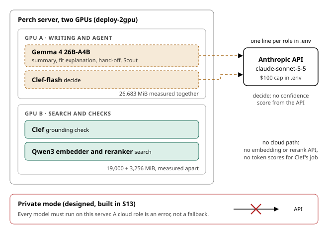

# Architecture

How Perch fits together, which steps of a brief use a model, what runs where in the two-GPU demo, and which steps can move to a cloud model through an API key. Model choices come from the S8 bench (Bench tab); memory figures are nvidia-smi readings from S8.

## How Perch fits together

- **Public sources only:** OpenAlex, NIH RePORTER, NSF Award Search and Grants.gov. The SBIR.gov API was down in S11, so small-business awards come from RePORTER and cover NIH only.
- **Fetchers and store:** plain code fetches each record and stores it with its source, link and fetch time. Numbers and dates are copied from records, never written by a model.
- **Route A, grants:** two small local models find and rank open calls. Eligibility rules between them drop anything the researcher cannot apply to.
- **Route B, industry leads:** plain code counts public signals per company. A company needs two kinds of signal to be shown. Every lead says it is inferred and not verified.
- **Models are bounded:** the chat model writes the profile summary and the fit explanations. Scout, the agent, can only call Perch's own tools.
- **The validator:** it checks every model output before it is shown. Code checks ids and numbers. Clef checks each sentence against the record it cites.
- **Other ways in:** private mode (S13) runs the same pipeline on self-hosted models and writes nothing. The MCP server (S14) offers Scout's tools to any MCP client.
- **The hand-off draft (S12):** the chat model writes only an opening paragraph. Code writes the rest, and the app never sends it.

## A brief, step by step

- **Code, no model:** fetching, eligibility, dates and the citation check are plain code. Numbers and dates are copied from records, never written by a model.
- **Search:** the embedder and reranker are small local models. Nothing in the back-test beat them measurably.
- **Writing:** the profile summary, fit explanation and hand-off draft are written by the chat model. Every one passes both validator layers before it is shown.
- **Grounding check:** Clef reads each sentence beside the record it cites, and flags a sentence the record does not support.
- **Scout and decide:** Scout calls only allowlisted tools. Decide gives typed yes-or-no and score answers with a confidence.

## Deployment choice: local, hybrid or cloud

The person who deploys Perch decides where the models run. This is a deployment decision, not a code change.

- **One path:** every model call goes through `perch/llm/` (standing rule 6). Each model role is chosen by a setting.
- **The settings:** `PERCH_LLM_DEFAULT` sets all roles. A per-role variable such as `PERCH_LLM_FIT_EXPLAINER` overrides one role. `PERCH_PROFILE` sets the local models. `PERCH_CLOUD` names the hosted model that visitors may turn on.
- **Fully local:** every role runs on self-hosted models. No API key is needed and no text leaves the server.
- **Hybrid:** models are local by default. A user may switch a session to Cloud. This is how the demo runs.
- **Cloud only:** every role runs on a hosted provider. This needs an API key and the deployer's agreement to the provider's terms.
- **The key type:** if a hosted provider is used, the deployer also decides whether the API key is a zero-data-retention key, if the provider offers one. The privacy statement should say which kind it is.
- **Documents:** a user's documents reach a hosted provider only by that user's informed consent, given for the session (standing rule 1 as amended on 2026-11-01). The deployer allows the choice with `PERCH_CLOUD_DOCUMENTS`.
- **Where to set it:** `.env.example` lists the variables. `docs/deploy.md` has the checklist for a production deployment.

## The demo on two GPUs, and the API swap

- **The swap:** set `PERCH_LLM_<ROLE>=anthropic:claude-sonnet-5-5` for one role, or `PERCH_LLM_DEFAULT` for all of them. Roles are profile summary, fit explainer, hand-off, Scout and decide.
- **What Sonnet measured:** a typical brief took 26 s and cost about $0.09. It passed both checks on 24 of 30 leads, against 28 for Gemma.
- **Decide on Sonnet:** it works, but the Anthropic API returns no token probabilities, so the answer comes without a confidence score.
- **What stays local:** Anthropic offers no embedding or rerank API, and Perch has no adapter for another provider of them. Clef's job needs token scores.
- **The GPU saving:** if every chat role moves to the API, GPU A no longer needs Gemma. Only Clef-flash would stay there, at about 7.4 GB.
- **The layout:** S9 deployed it and measured the two cards together. The memory figures here were measured in separate S8 runs.
- **Private mode:** built in S13. It refuses any model that is not on this server.
