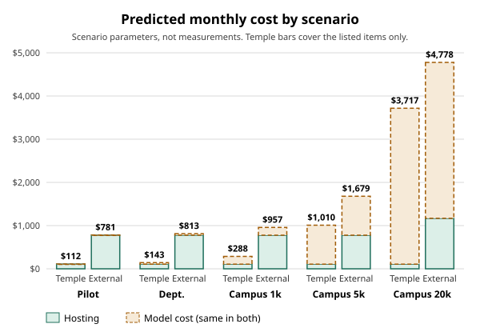

# Cost model

*Generated by `scripts/cost_model.py`; do not edit by hand. Re-run it with `python3 scripts/cost_model.py` (add `--ledger main=PATH --ledger deploy=PATH` to re-read the spend ledgers). Public prices were fetched on 2026-11-05.*

## Summary

- **What this is:** a prediction of the monthly hosting and model cost of Perch, built from measured costs, public list prices and labelled assumptions.
- **Model cost:** a measured researcher brief costs $0.0833 and a measured student brief $0.1135. Model cost scales with use and is the same wherever Perch is hosted.
- **Hosting, external:** a rented 1-GPU cloud setup with a database, Redis and a web VM costs about $777 a month at list price, whatever the use. The no-GPU setup costs about $711.
- **Hosting, Temple:** the only costs that can be priced are one GPU card and its power, about $107 a month. Server, data-centre and staff costs are UNVERIFIED and not included, so this is a floor and not a total.
- **Scenarios:** at 25 users the total is dominated by hosting, about $781 external. At 5,000 users model cost is $903 and hosting $777.
- **How sure:** the unit costs are measured on 3 to 30 runs each. The user counts and activity rates are assumptions, not facts about Temple.

## Inputs

| Input | Value | Kind | Source |
|---|---|---|---|
| Researcher brief, 10 leads | $0.0833 mean, $0.0807 median, range $0.0766 to $0.0957, n=5 | MEASURED | `bench/results/s38_cost/researcher_briefs.txt` (2026-11-04, Haiku 5.5 summary, Sonnet 5.5 fit) |
| Student brief, 20 leads explained | $0.1135 mean, $0.1143 median, range $0.1063 to $0.1199, n=3 SYNTHETIC personas | MEASURED | `bench/results/s46_student_real/counts.csv` |
| Scout question | $0.0139 mean, $0.0103 median, n=30 (22 tasks, 8 restraint) | MEASURED | `bench/results/scout_s38_cloudgpu/` (Sonnet 5.5) |
| Hand-off draft | $0.0161 mean, n=2 (whole Scout turn, not the draft alone) | MEASURED, thin | same file, tasks h01 and h02 |
| Cover-points run | $0.0368, n=1 (whole Scout turn, two tool errors) | MEASURED, thin | same file, task p01 |
| Spend ledger, main | 2323 calls, $12.45 from 2026-10-29 to 2026-11-05; haiku-5-5 n=777 mean $0.00062 median $0.00008 per call; sonnet-5-5 n=1546 mean $0.00774 median $0.00611 per call | MEASURED | the main ledger (fields at, cache_read_tokens, cache_write_tokens, cost_usd, input_tokens, model, output_tokens) |
| Spend ledger, deploy | 648 calls, $3.38 from 2026-11-05 to 2026-11-05; haiku-5-5 n=18 mean $0.00029 median $0.00003 per call; sonnet-5-5 n=630 mean $0.00535 median $0.00352 per call | MEASURED | the deploy ledger (fields at, cache_read_tokens, cache_write_tokens, cost_usd, input_tokens, model, output_tokens) |
| GPU worker memory | 6,544 MiB at 24 briefs in flight, 8,940 MiB at 48 | MEASURED | `docs/deploy.md` section 10; so a 24 GB L4 fits |
| Postgres data directory | 100 MB, both databases, n=1 | MEASURED | `du` of the test deploy's Postgres base directory, 2026-11-05 |
| GPU worker rate | 38 to 40 briefs a minute, fake provider | MEASURED | `docs/RESULTS.md` load test |
| Web process | 1 process met the 250-user target | MEASURED | `docs/RESULTS.md` load test |
| CPU rerank, 14 candidates, 16 cores | 9.386 s | MEASURED | `docs/RESULTS.md` CPU timings |
| AWS g6.xlarge (1 NVIDIA L4 24 GB, 4 vCPU, 16 GiB), US East, Linux, per hour | $0.8048 | PUBLIC PRICE | https://instances.vantage.sh/aws/ec2/g6.xlarge (aggregator of AWS list price; specs from https://aws.amazon.com/ec2/instance-types/g6/), fetched 2026-11-05 |
| Google g2-standard-4 (1 NVIDIA L4 24 GB), us-central1, per hour | $0.7068 | PUBLIC PRICE | https://gcloud-compute.com/g2-standard-4.html (aggregator of Google list price), fetched 2026-11-05 |
| AWS c7i.4xlarge (16 vCPU, 32 GiB), US East, Linux, per hour | $0.7140 | PUBLIC PRICE | https://instances.vantage.sh/aws/ec2/c7i.4xlarge, fetched 2026-11-05 |
| AWS c7i.xlarge (4 vCPU, 8 GiB) for a web process, US East, Linux, per hour | $0.1785 | PUBLIC PRICE | https://instances.vantage.sh/aws/ec2/c7i.xlarge, fetched 2026-11-05 |
| AWS RDS db.t4g.medium (2 vCPU, 4 GiB), PostgreSQL, per hour | $0.0650 | PUBLIC PRICE | https://instances.vantage.sh/aws/rds/db.t4g.medium (engine and region not confirmed on the page), fetched 2026-11-05 |
| AWS ElastiCache cache.t4g.micro, Redis, per hour | $0.0160 | PUBLIC PRICE | https://instances.vantage.sh/aws/elasticache/cache.t4g.micro (engine and region not confirmed on the page), fetched 2026-11-05 |
| NVIDIA L4 24 GB card, new, lowest in-stock US retail listing in a price tracker dated 2026-10-09 | $3,599 | PUBLIC PRICE | https://gpudojo.com/l4 (found by search; the same search showed $2,824 for a PNY kit with zero stock, a CDW page showing 'Call', and a Feb 2026 estimate of $2,000 to $3,000), fetched 2026-11-05 |
| NVIDIA L4 maximum power (TDP), watts | 72 W | PUBLIC PRICE | https://www.nvidia.com/en-us/data-center/l4/, fetched 2026-11-05 |
| Pennsylvania commercial electricity, August 2026 (preliminary), USD per kWh | $0.1393/kWh | PUBLIC PRICE | https://www.eia.gov/electricity/monthly/epm_table_grapher.php?t=epmt_5_6_a, fetched 2026-11-05 |
| Anthropic list price, Sonnet 5.5 | $2 in, $10 out, $2.50 cache write, $0.10 cache read per MTok | PUBLIC PRICE | https://platform.claude.com/docs/en/docs/about-claude/pricing, fetched 2026-11-05 |
| Anthropic list price, Haiku 5.5 (up to 100K tokens) | $0.10 in, $0.50 out, $0.125 cache write, $0.01 cache read per MTok | PUBLIC PRICE | same page, fetched 2026-11-05 |
| Active users a month, N | 25, 200, 1,000, 5,000, 20,000 | ASSUMPTION | scenario parameter; Temple's headcount is not used |
| Activity per user a month | 1 brief (half researcher, half student), 4 Scout questions, 0.5 hand-off drafts, 0.5 cover-points runs | ASSUMPTION | scenario parameter |
| Busy share of users on at once | 5% | ASSUMPTION | sizes web VMs |
| Worker utilisation at busy hour | 10% GPU, 25% CPU | ASSUMPTION | sizes workers |
| Card life, Temple | 36 months | ASSUMPTION | straight-line |
| Server chassis, rack, data-centre, network, staff time, backups, support | no figure | UNVERIFIED | the record holds none; do not guess |

**Sanity check against list prices.** The five researcher briefs' recorded tokens, priced entirely at Sonnet 5.5 list prices, give a mean of $0.1072. That is an upper bound, because the profile summary ran on Haiku. The recorded mean is $0.0833, below the bound, so the ledger prices and the public prices agree.

**Reconciling with the record.** `docs/ROADMAP.md` section 4 says a researcher brief cost a mean of $0.0833 over five briefs. Recomputing from the saved file gives $0.0833, n=5, so this model uses the same number. The earlier $0.0915 (S8) is older code and is not used.

**What the ledgers can and cannot say.** The ledgers record time, model, token counts and cost for each call. They carry no job, role or brief id, so a per-brief cost cannot be grouped from them without guessing. The per-unit costs above therefore come from the saved bench files, which were run with a known job. The ledgers give per-call figures and totals. The ledger totals also include development and test runs, so they are not a usage rate.

**Budgets on record.** These are placeholders in `.env.example` and `docs/ROADMAP.md`, not measured:

| Limit | Default | Demo Day setting |
|---|---|---|
| Guest session, per day | $0.10 | $0.30 |
| One address (guests), per day | $0.30 | $4.00 |
| All guests, per day | $3.00 | $8.00 |
| Signed-in account, per day | $0.50 | raised on the test deploy; value not in the repo |
| Whole site | $100 (development value) | deploy cap set separately |

## Formulas

- **Model cost a month:** `N x (0.5 x R + 0.5 x S + q x C + h x H + v x V)`, with R and S the researcher and student brief costs, C the Scout question cost, H the hand-off cost, V the cover-points cost, q, h and v the activity rates. Unit costs are the measured means.
- **External, GPU profile:** `workers x GPU price x 730 + web VMs x web price x 730 + Postgres x 730 + Redis x 730`. Workers = `ceil(briefs a month / (38 x 60 x 730 x 0.1))`. Web VMs = `ceil(N x 0.05 / 250)`.
- **External, CPU profile:** the GPU VM is replaced by a 16-vCPU VM. Workers = `ceil(briefs x 9.386 s / (730 x 3600 x 0.25))`. This counts the rerank only, so it is a lower bound; MiniCheck time is not included.
- **Temple:** `card price / 36 + TDP x 730 h x PA commercial rate`. The card runs at its full rated power, an upper bound for the card, and the rest of the server is not counted.

## Scenarios

Monthly cost in US dollars. Model cost is the same in every column. External GPU uses the AWS price; the Google price is $516 a month for the GPU VM against $588.

| Scenario | Briefs a month | Model cost | Temple hosting (listed items) | Temple total | External GPU hosting | External GPU total | External CPU hosting | External CPU total |
|---|---|---|---|---|---|---|---|---|
| Pilot (25 active users) | 25 | $5 | $107 | $112 + UNVERIFIED | $777 | $781 | $711 | $715 |
| Department (200 active users) | 200 | $36 | $107 | $143 + UNVERIFIED | $777 | $813 | $711 | $747 |
| Campus N=1,000 (1,000 active users) | 1,000 | $181 | $107 | $288 + UNVERIFIED | $777 | $957 | $711 | $891 |
| Campus N=5,000 (5,000 active users) | 5,000 | $903 | $107 | $1,010 + UNVERIFIED | $777 | $1,679 | $711 | $1,613 |
| Campus N=20,000 (20,000 active users) | 20,000 | $3,610 | $107 | $3,717 + UNVERIFIED | $1,168 | $4,778 | $1,102 | $4,712 |

Hosting detail for the pilot, external GPU: GPU VM $588, web VM $130, Postgres $47, Redis $12. Temple: card $100 a month over 36 months, power $7.32.
At N=20,000 the sizing rules give 1 GPU worker(s) and 4 web VM(s); the CPU profile needs 1 VM(s) by the rerank-only count.

Figure: stacked monthly cost, hosting and model cost, Temple against external GPU.

The table above is the text version of the chart. The Temple bars exclude every UNVERIFIED item.

## Not included

- **Temple, UNVERIFIED:** server chassis and host CPU, rack space, cooling, network, backup storage, spares, and staff time to run it. No figure is on record, so none is used.
- **External:** storage and data egress, load balancer and TLS, backups, monitoring, support plans, taxes, reserved or committed discounts, and the second Postgres for the key database. At 100 MB of data storage is small, but its price is UNVERIFIED here.
- **Model cost:** guests, the scope gate and the daily jobs, Scout bench runs, retries beyond those in the measured briefs, and any rate-tier or contract terms. A different model or provider changes every unit cost.
- **Safety margin:** no headroom for peaks. The CPU profile count excludes MiniCheck time.
- **Student briefs:** measured on 3 SYNTHETIC personas, so real CVs may differ. Hand-off and cover-points costs rest on 2 and 1 Scout runs, so treat them as rough.

## Sensitivity

One input at a time is raised by 50%, at N=5,000, external GPU. Base total $1,679 a month ($903 model, $777 hosting).

| Input raised 50% | Change in monthly total | Share of base |
|---|---|---|
| GPU VM price | +$294 | 17.5% |
| Brief cost, or briefs per user (1 a month) | +$246 | 14.6% |
| Scout questions per user (4) | +$139 | 8.3% |
| Scout question cost | +$139 | 8.3% |
| Hand-off and cover-points cost | +$66 | 3.9% |
| Web VM price | +$65 | 3.9% |
| Postgres and Redis price | +$30 | 1.8% |

- **What moves it most:** at this size, 'GPU VM price' and then 'Brief cost, or briefs per user (1 a month)'. Hosting is flat in use, so it matters most for the pilot.
- **At the pilot:** hosting is 99% of the external total, so the GPU VM price decides it. Use or the GPU choice (a CPU VM, or a card bought) changes the result more than any model input.
- **Not tested:** the model price per token and the share of briefs that hit the cache. The cache read price is $0.10 per MTok on Sonnet 5.5, against $2 for fresh input, so cache use is large for the real cost.

