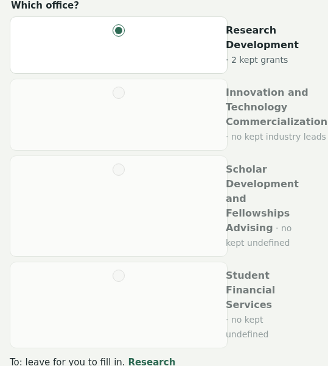
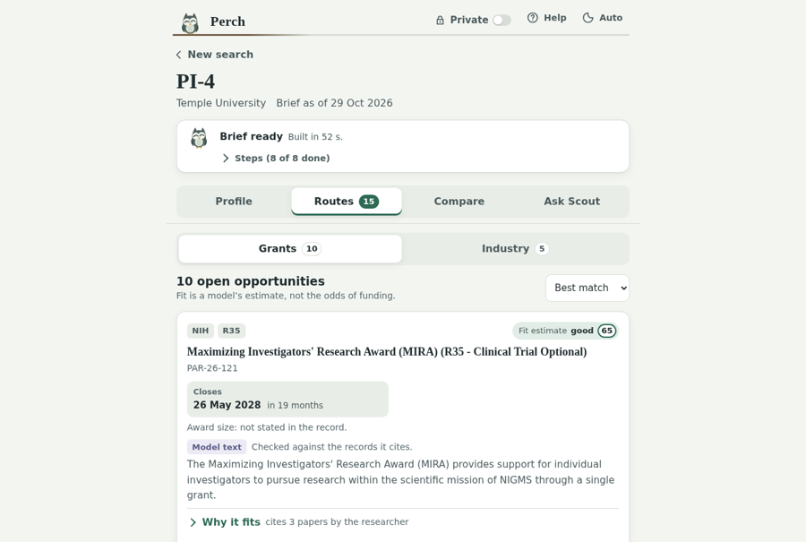
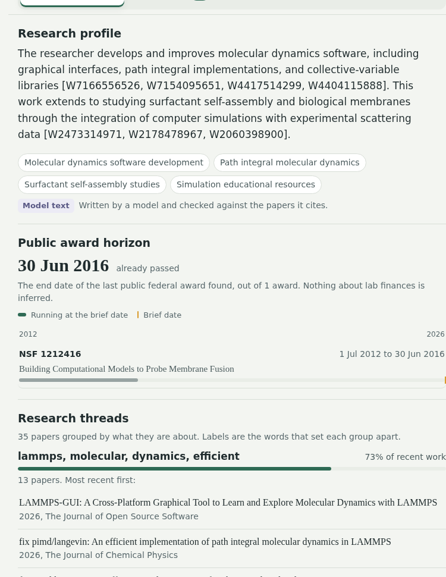
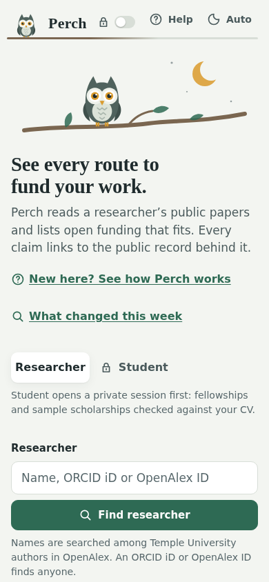
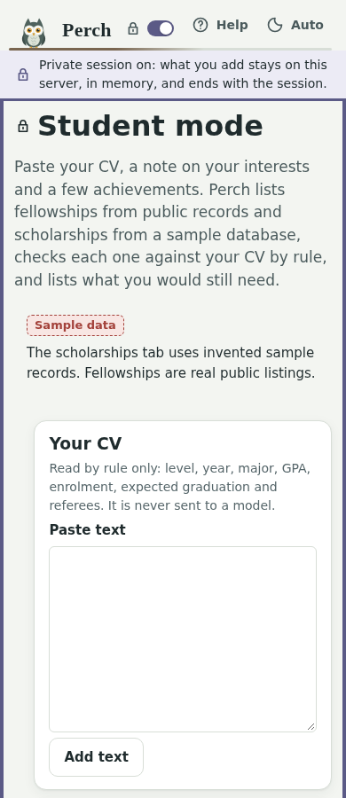
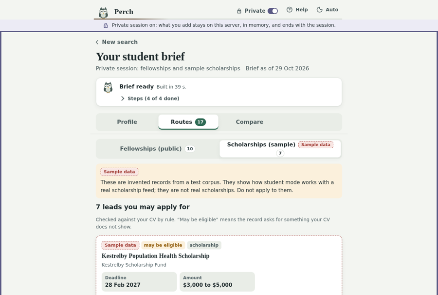
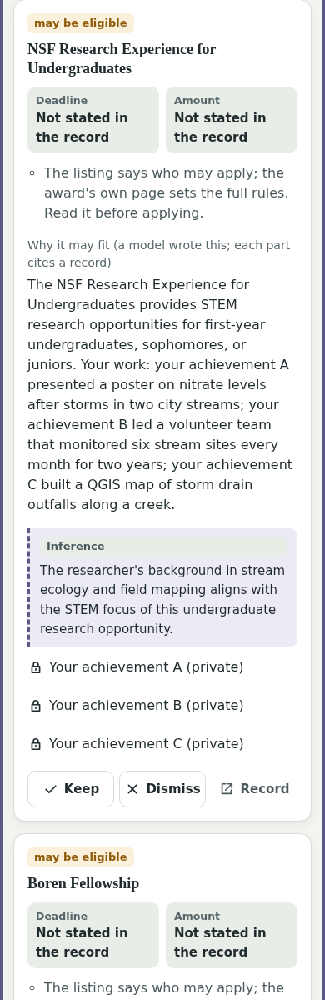
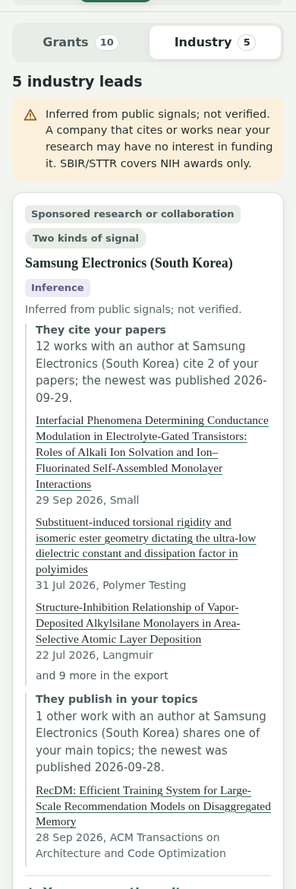
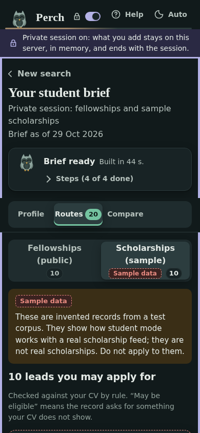

# UX audit for three audiences (S21)

Perch-dev walked every screen of the live demo on 2026-10-29, on the public URL, as each audience. This is an expert walkthrough with automatic checks. It is not a study with real users; no undergraduate, graduate student or PI was observed.

## How the walk was done

- **Runner:** `scripts/ux_walk.py` drives the real app in headless Chromium. Each state is screenshotted and checked with axe-core 4.10.2, a touch-target probe, a sideways-scroll probe and a private-mode probe. The raw results are in `build/ux/report-*.json`, which is not committed.
- **PI:** the demo researcher PI-4 (A5026494099), found by OpenAlex id. Laptop (1280 px) and phone (390 px), each in light and dark. Screens: Find, candidate, Profile, Routes (grants and industry), why it fits, evidence panel, keep bar, Compare, hand-off, export links, Ask Scout, What changed, Help.
- **Students:** the three SYNTHETIC personas from S17: undergraduate (persona-ug), part-time master's (persona-masters) and PhD (persona-phd). Each was walked from Find through the Student button, the form, a live brief, Profile, Fellowships, Scholarships, the evidence panel on a sample record, Compare with the code-written draft, and ending the session. Each persona was captured on a phone and a laptop; the PhD walk was in dark mode.
- **Private researcher:** the SYNTHETIC persona-1 in private mode on a laptop: the header switch, three documents, a private-only brief, Profile, Routes and Help with the session on.
- **Totals:** 108 captured states across 14 screens; 2 steps failed in the automation, both on the phone hand-off (finding M1).

## Private mode at a glance

- **Result:** every audience can tell when private mode is on. In all 54 student and private states, the header switch read "on", the frame line under the header showed, and the coloured edge was drawn. All three went off after the session ended.
- **On a phone:** the switch shows a lock and a toggle but no word. The frame line under it says "Private session on", so the state is still clear at a glance (screenshot 5).
- **One gap:** the frame line is part of the header, so it scrolls away with it on a long list. The coloured edge stays. This is a could-fix.

## Findings, ranked

Severity: **Must-fix** means broken, misleading, or a serious accessibility failure. **Should-fix** means an audience stalls or misreads. **Could-fix** means polish.

### Must-fix

| # | Where | Audience | Finding |
|---|---|---|---|
| M1 | Compare, hand-off | PI | The office picker is broken. It lists the two student offices on a researcher's brief and labels them "no kept undefined". The radio cards render empty, with their labels outside the box. On a phone this pushes the page 149 px sideways, and the automated walk could not press Draft the email at 390 px. Cause: S18 added SDFA and SFS to the shared office list (`perch/compare.py` returns all four), and `web/handoff.js` has no words for the student routes. |
| M2 | Every screen | All | The owl ("Say hello to Scout") is a button inside an `aria-hidden` region on Find and in the progress branch. A screen reader skips it while the keyboard still lands on it; on Find it is reached twice. axe rates this serious, on 77 states. |
| M3 | Compare, evidence panel | All | The comparison table and the evidence panel scroll but cannot take keyboard focus, so a keyboard user cannot scroll them (axe `scrollable-region-focusable`, serious). |
| M4 | Routes | PI | The list is sorted "Best match" but shows "Fit estimate weak 0" on the 4th, 5th, 6th and 7th cards, above a "strong 85". The order is the pipeline order that the back-test measures, and the fit number is a separate model estimate. Nothing says so, so a PI reads it as the tool contradicting itself. |
| M5 | Student explanations | Students | The inference line calls the student "the researcher" ("The researcher's background in stream ecology..."). |
| M6 | Contrast | All | Two misses: the Model tag on Help (4.07 to 1) and the small notes in Compare cells in dark mode (4.31 to 1). |

### Should-fix

| # | Where | Audience | Finding |
|---|---|---|---|
| S1 | Find | Students | The page speaks to researchers only: "fund your work", "a researcher's public papers", and the field label "Researcher". Student is a smaller second button under the hero, with no heading. An undergraduate has to read the hint to know they are welcome. |
| S2 | Vocabulary | Students | "Routes", "brief", "leads" and "New search" are researcher words. A student brief's back link says "New search" and goes to a researcher search. "Your CV" may stop an undergraduate who has a résumé, not a CV. |
| S3 | Profile | PI | The summary shows raw ids in brackets ("[W7166556526, W7154095651, ...]"). Elsewhere the same ids are readable chips. |
| S4 | Profile | PI | The same paper appears up to three times in a thread: the journal version and two arXiv copies. |
| S5 | Routes | PI | Three cards for one announcement family (R21, R03 and R01 of the same "Dissemination and Implementation Research in Health"). Each costs a phone screen. |
| S6 | Fellowship cards | Students | All 10 public fellowship cards show "Deadline: Not stated in the record" and "Amount: Not stated in the record" in two large boxes, the same rule line, and an expanded explanation. Ten leads fill 11,000 px on a phone. |
| S7 | Industry cards | PI | Each industry card is about 1,200 px tall on a phone, with three paper titles per signal shown in full. "Samsung Electronics (South Korea)" and "Samsung (South Korea)" are two separate leads. |
| S8 | Card actions | Mixed | Grant cards say "Evidence"; student cards say "Record" for the same action. |
| S9 | Student tabs | Students | "Scholarships (sample)" lists sample records named "Fellowship" (for example a sample "Graduate Fellowship in Systems Neuroscience"), next to a tab called Fellowships. The draft for those goes to Student Financial Services. |
| S10 | Laptop | All | The content is one 720 px column on a 1280 px screen. The evidence panel then covers the list it explains. |
| S11 | Touch targets | All | Paper chips under "Why it fits" are 28 px tall, and student record chips are 40 px. Both pass WCAG 2.2 (24 px) but miss the app's own 44 px rule. Inline company and paper links on industry cards are 23 px. |
| S12 | Headings | Students, private | The document cards jump from h1 to h3 (axe `heading-order`). |

### Could-fix

| # | Where | Finding |
|---|---|---|
| C1 | Phone tabs | "Ask Scout" wraps onto two lines at 390 px. |
| C2 | Header | The private frame line scrolls away with the header; only the coloured edge stays. |
| C3 | Evidence panel | `<aside role="dialog">` is not an allowed role (axe, minor). |
| C4 | Steps | The "Steps (8 of 8 done)" summary is 36 px tall. |

## What worked

- **Provenance:** every grant date and amount reads as copied ("Not stated in the record"), and the evidence panel opens the record on a phone as a bottom sheet.
- **Sample data:** every sample card, the Scholarships tab, the evidence panel on a sample record and the student Compare carry the Sample data badge or banner. No audience could take a sample record for a real one.
- **Model text:** model text is labelled on every card, and the student CV note says it is read by rule and never sent to a model.
- **Keyboard:** focus was visible on every step of both keyboard paths, and the tab order follows reading order apart from the owl (M2).
- **Motion:** with reduced motion, no animation loops at rest.

## Screenshots

## Information architecture

- **One app or two:** one app with a mode switch can serve all three audiences. The data, the evidence panel, the badges and the private session are shared, and splitting them would duplicate the code that enforces the standing rules.
- **What should differ by audience:** the entry point, the words and the defaults. Find should offer two equal doors, "I'm a researcher" and "I'm a student", each with its own one-line promise. A student brief should use student words: "Your options" for Routes, "Start over" for New search, "CV or résumé".
- **Undergraduate and graduate students:** the same flow serves both. The CV parse already reads the level, and the fellowship list already differs by level. No separate door is needed.
- **Defaults:** a student lead's explanation should start collapsed, as a PI's does. Fields a whole source never states (deadline and amount on the SDFA list) should fold into one line, not two boxes.
- **What stays in every option:** provenance on every claim, the Sample data badge on every sample record, numbers copied from records, and nothing sent.

## Options for S22

Each estimate counts the knock-on work Dakshitha asked for after any UI change. That means refilming the six README clips (`scripts/tour/film.py`), retaking `docs/screenshots/` and the README student screenshot, rebuilding the tracker's UI preview (S19 moved the student flow here), updating Help (`web/help.js`), and republishing the artifacts. Selector changes also break `scripts/tour/film.py`, `scripts/screenshots.py`, `scripts/build_ui_preview.py`, `scripts/ux_walk.py` and the Node tests in `tests/test_web.py`. A session here means one context window.

| Option | What it covers | Sessions | Risk |
|---|---|---|---|
| A. Targeted fixes | M1 to M6, S3, S4, S8, S11, S12, C1, C3, C4. No layout or wording change beyond these. | About 1: 0.5 build, 0.5 refilm and republish | Low |
| B. Redesign the core screens (recommended) | Everything in A, plus the two-door Find (S1), student vocabulary (S2), compact cards for grants, fellowships and industry (S5, S6, S7), sample "fellowships" labelled as such (S9), a two-column laptop layout with the evidence panel beside the list (S10), and the order explained (M4). The visual style, the components and the API stay as they are. | About 2: 1.2 build, 0.8 refilm, Help and republish | Medium. Each screen is a clean commit, so it can stop part-way. |
| C. Full redesign and rebuild | A new visual system and new screens for every flow, designed from scratch per audience. | About 4: 1 design, 2 build, 1 refilm and regression | High: freeze is Thu 5 Nov 12:00, and the cut order already names the rebuild first. |

- **Recommendation: B.** The audit found defects and a vocabulary problem, not a broken structure. The structure that works (one app, a private state, shared evidence and badges) is exactly what C would throw away. B fixes what a student stalls on and what a PI misreads, and every step can stop at a clean commit.
